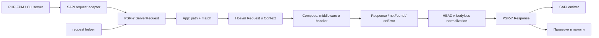

# Архитектура и проверка

## Основные решения

| Решение | Причина и цена |
| --- | --- |
| PHP `^8.5`, `strict_types`, Composer/PSR-4 | Требование пользователя; не тратить объём на старые ветки PHP |
| PSR-7 Request/Response, PSR-17 factories | Использовать PHP-экосистему вместо самостоятельной реализации HTTP messages |
| App реализует PSR-15 RequestHandlerInterface | Ядро можно встроить в другой PHP server pipeline |
| Hono-style callable middleware внутри | Сохранить Context и привычный onion API; готовые PSR-15 middleware подключаются через обязательный bridge MVP |
| Синхронный pipeline | Работает в FPM; Fibers/event loop не обязательны и не скрываются внутри `$next()` |
| Ordered router: таблица + скомпилированные шаблоны | Простое воспроизводимое поведение; O(N) matching приемлем как исходная точка, но не обещание скорости |
| Один Composer-пакет до 1.0 | Не создавать монорепозиторий и отдельные пакеты до появления реальной необходимости |

Источники стандартов: [PSR-7](https://www.php-fig.org/psr/psr-7/), [PSR-15](https://www.php-fig.org/psr/psr-15/), [PSR-17](https://www.php-fig.org/psr/psr-17/). Это выбранная архитектура PHP-порта, а не внутренняя архитектура Hono.

## Зависимости

- Runtime: `psr/http-message`, `psr/http-factory`, `psr/http-server-handler`, [nyholm/psr7](https://github.com/Nyholm/psr7) как реализация по умолчанию, [nyholm/psr7-server](https://github.com/Nyholm/psr7-server) для SAPI request creation.
- В MVP при T21 добавить `psr/http-server-middleware` для bridge. Ядро принимает PSR interfaces, фабрики можно передать явно; service discovery/container не нужен. Сторонние пакеты для integration tests устанавливаются как dev dependencies, а не становятся обязательными runtime-зависимостями пользователей.
- Dev: PHPUnit, PHPStan и один formatter; выбрать совместимые с PHP 8.5 стабильные версии в T01. Не фиксировать в этом плане непроверенные номера релизов.
- JSON/PCRE нужны ядру; `ext-fileinfo` — static serving, `ext-zlib` — optional compress. Особые расширения и версия FrankenPHP проверяются в соответствующих задачах, они не требуются для запуска MVP.
- Node и upstream checkout нужны только разработчикам для обновления fixtures, не пользователям Composer-пакета.

Нулевые зависимости, как у JavaScript Hono, не являются целью: в PHP пришлось бы заново написать HTTP message layer. Альтернативную PSR-7 реализацию проверить smoke-тестом с явными фабриками, не добавляя runtime discovery.

## Поток запроса



Runtime bindings передаются в новый Context. Router содержит конфигурацию и callable handlers, но не данные последнего запроса. App freezing делает startup и request processing разными фазами.

## Предлагаемые файлы реализации

Структура ниже — план. Сейчас эти файлы создавать не нужно.

```text
src/
  Hono.php
  Context.php
  HonoRequest.php
  HttpException.php
  Internal/Compose.php
  Router/RouterInterface.php
  Router/OrderedRouter.php
  Router/Route.php
  Http/ResponseFactory.php
  Adapter/Sapi.php
  Adapter/SapiEmitter.php
  Middleware/...
  Helper/...
tests/
  Unit/
  Contract/
  Integration/
  Fixtures/hono-v4.13.16/
tools/conformance/
examples/
benchmarks/
docs/
```

RouterInterface ограничить `add` и `match`; match отдаёт ordered list из handler, route metadata и params. Это единственная заранее нужная замена алгоритма. Не строить универсальную систему plugins, events, DI, ORM или route attributes.

Compose управляет единственной финализацией, index guard для `$next()`, текущим route index и error boundary. Он не должен знать про SAPI. HonoRequest отвечает за lazy cached body, extraction и validated data. Context отвечает за состояние и удобные response factories. Emitter отвечает за I/O и владельцев streams.

## Формы и размер тела

Raw body обычно читается лениво через общий ограниченный reader. `bodyLimit()` перед `$next()` проверяет Content-Length и вычитывает доступный raw stream в ограниченный кеш с остановкой не позднее limit+1 bytes; слишком большое тело даёт 413 даже при handler, который тело не читает. Дальнейшие readers используют этот кеш. Без middleware действует конечный configurable предел ленивого буферизования ядра: предлагается 8 MiB, окончательно закрепляется T02. Middleware может понизить его для маршрута; повышение задаётся конфигурацией приложения. Фактические bytes считаются независимо от Content-Length.

Urlencoded парсится без `parse_str`, чтобы сохранить Hono query/form semantics. Multipart в MVP берётся из SAPI/PSR parsed data с marker `php_hono.multipart_parsed`; framework не восстанавливает утраченные PHP повторения и исходные имена. Известное превышение `post_max_size`, доступные upload errors и отсутствие parser — разные диагностируемые случаи. Если SAPI не оставил bytes/размер или признак ошибки, framework не обещает восстановить причину пустых данных; transport limits обязательны. Собственный универсальный MIME parser не входит в оценку.

## PSR-15 bridge в MVP

Поддержка готовых сторонних middleware — обязательное требование пользователя. App является PSR-15 request handler; T21 добавляет `PhpHono\Middleware\Psr15::wrap(MiddlewareInterface $middleware): callable` для включения стороннего объекта в Hono pipeline без изменения пакета. Downstream `RequestHandlerInterface::handle($request)` временно устанавливает новый raw request и выполняет оставшийся pipeline. Attributes передаются endpoint; route match и path params уже выбраны и не пересчитываются. Переписывание method/URI внутри bridge запрещено явной ошибкой.

До передачи доступного raw body стороннему middleware bridge обеспечивает повторно читаемое тело: получает bytes через общий bounded reader/cache и передаёт PSR stream с начальной позицией. Если Hono reader уже прочитал non-seekable источник, используется кеш, а не повторное чтение источника. Сам кеш остаётся доступным endpoint, даже если сторонний middleware сдвинул cursor PSR stream. Это может потребовать буферизации до middleware и подчиняется пределу тела приложения; не обещать необработанные streaming uploads через bridge.

Body cache сохраняется, если forwarded request содержит тот же подготовленный stream object (обычные withAttribute/withHeader). При замене body инвалидируются bytes и decoded caches, новая версия снова подчиняется лимитам. При изменении Content-Type или parsed body пересчитываются зависимые form interpretations; PSR attributes и parsed body должны быть доступны через новый raw request. Проверить цепочку Hono reader → PSR getBody() → endpoint text/json(), а также withAttribute после чтения non-seekable body.

Возвращённый PSR middleware response точно устанавливается в Context через внутреннюю операцию замены **без наследования прежних headers**, в том числе после downstream. Публичная политика `setResponse()` для этого не подходит: она восстановила бы header, удалённый PSR middleware через `withoutHeader()`. При выходе из вложенного вызова request view восстанавливается для upstream middleware. Проверить short-circuit, изменения/удаления headers (включая Set-Cookie), body/attributes, exception и повторный вызов downstream. Это сложнее простой смены сигнатуры и потому выделено в отдельную задачу.

Hono error boundary остаётся основным: endpoint exceptions превращаются в Response до возврата в PSR middleware. Компоненты, которым требуется поймать исходное исключение endpoint, не эквивалентны `onError`. Компоненты с собственными Laravel/Symfony contracts, double-pass `(request, response, next)` и повторными downstream вызовами автоматически не поддерживаются.

Middleware, изменяющее URI/method **до routing**, можно разместить во внешнем PSR-15 pipeline, конечным handler которого является App. Это стандартная композиция через `RequestHandlerInterface`, а не rematch внутри bridge. Внешний pipeline отвечает за свои ошибки до/после App и передачу финального Response emitter; правила HEAD/bodyless применяются к итоговой отправке.

T21 должна включать интеграции минимум с двумя реальными пакетами: [middlewares/uuid](https://github.com/middlewares/uuid) для изменения request/response headers и [middlewares/response-time](https://github.com/middlewares/response-time) для post-processing Response. Точные совместимые версии фиксируются при выполнении задачи после установки на PHP 8.5. Объекты устанавливаются обычным Composer и подключаются через wrap; собственные тестовые middleware дополнительно проверяют attributes, удаление Set-Cookie, замену body, short-circuit и exceptions. До успешного прогона совместимость конкретных версий не объявляется подтверждённой.

## Streaming и постоянный процесс

Для T28 сначала закрепить тип результата, который несёт PSR-7 metadata и отложенный producer, и способ передачи его emitter. Нельзя заставлять обычные consumers PSR-7 случайно запускать generator при чтении headers. В обычном `handle()` остаётся ResponseInterface; streaming extension должна сохранять этот контракт через отдельную поддерживаемую реализацию response/body либо быть явно отдельным API. Решение и contract tests входят в T28 до реализации emitter.

`stream/streamText/streamSSE` не должны буферизовать весь output. HEAD не запускает producer. Compression и ETag пропускают streaming responses. После отправки headers ошибки логируются и закрывают поток; c.onError не обещает изменить уже отправленный статус. Измерить flush и отключение клиента на реальном сервере, описать влияние proxy buffering.

Первый worker adapter — [FrankenPHP worker mode](https://frankenphp.dev/docs/worker/): boot один раз, новый request state на каждый вызов. T29 проверяет reset после нормального ответа и ошибки, cleanup streams, ограничение количества запросов/restart, отсутствие роста retained state. Этот выбор не означает поддержку всех event-loop runtimes.

## Проверка совместимости

В T02 создать manifest с полями `upstreamVersion`, `upstreamCommit`, scenario id, source test, feature, classification (`compatible`, `intentional-difference`, `unsupported`), expected output и explanation. Никакой зависимости от `main`/`latest` при запуске CI.

JS harness исполняет маленькие эквивалентные приложения на зафиксированном upstream; PHP harness исполняет те же сценарии через `request/handle`. Сохраняются HTTP status, список headers, body и наблюдаемая последовательность middleware. Fixtures доступны offline; команда regeneration требует Node и upstream checkout с проверенным SHA.

Нормализовать только несущественные различия: регистр и порядок имён headers, динамические Date/request ID по явно заданному правилу. Сохранять порядок многозначных headers, отдельные Set-Cookie, bytes обычного тела и middleware trace. JSON сравнивать структурно в сценариях JSON API с сохранением различия object/array и безопасным диапазоном чисел. Отличия HTML/escaping и тела text сравнивать побайтно. Нельзя нормализацией скрывать несовместимость.

| Группа | Обязательные сценарии |
| --- | --- |
| Routing | Порядок overlapping matches, strict slash, wildcard границы, optional/regex, params на middleware, route snapshot/basePath |
| Compose | Onion, short-circuit, два next, void без next, возврат после next, явная замена, exceptions до/после next |
| HTTP | HEAD/404/OPTIONS, bodyless statuses, header append/remove, несколько cookies, HttpException и failing onError |
| Request | Повторяющиеся query, пустое/отсутствующее, unusual keys, encoded slash, malformed encoding, повторное чтение non-seekable body |
| Parsing | JSON errors/types, urlencoded duplicates/all/[]; отдельные PHP multipart tests и upload errors |
| Middleware | CORS preflight/error/Vary, body limit без длины и с ложной длиной, cookie attrs, validation early response |
| Runtime | Реальный FPM и CLI server, повторные requests, emitter без body, request scope; в 1.0 worker/streaming |

Каждая функциональная задача содержит свои тесты. T19/T31 проверяют взаимодействия, а не впервые добавляют тесты после реализации. Fuzz/property tests использовать целево для path/query/body parser и header boundary; не считать количество тестов метрикой готовности.

## CI и производительность

Обязательная CI-ветка — PHP 8.5; будущие PHP minor добавлять после проверки. Команды: Composer validate/install/audit, formatter check, PHPStan, PHPUnit; PSR adapter integration и pinned conformance запускаются воспроизводимо. Linux/FPM проверяется в CI, локальная разработка допустима на macOS.

Benchmarks разделить на router match, cold boot/registration, full in-process dispatch, FPM и worker HTTP. Наборы: 10/100/1000 маршрутов, hit/miss, static/param/wildcard и 0/1/5/10 middleware. Публиковать PHP version, OPcache/JIT, зависимости, CPU, число повторов, latency/throughput/peak memory; cold/warm результаты не смешивать.

Не утверждать, что PHP-порт «такой же быстрый, как Hono», и не переносить JS benchmark numbers на PHP. T30 может закончиться отчётом без смены алгоритма, если улучшение не доказано. Корректность и порядок handlers не разменивать на скорость.
